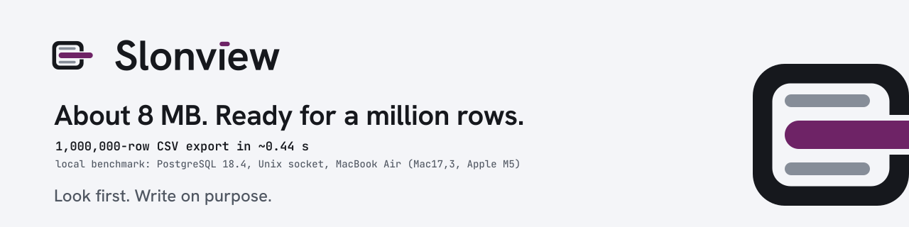

<picture>
  <source media="(prefers-color-scheme: dark)" srcset="docs/brand/identity/readme/readme-header-dark.png">
  <source media="(prefers-color-scheme: light)" srcset="docs/brand/identity/readme/readme-header-light.png">
  
</picture>

# Slonview

**About 8 MB. Ready for a million rows.**

A small, open-source viewer for PostgreSQL®: about 8 MB on disk, pages through
million-row tables, and read-only by default.

On a local database, Slonview exports a 1,000,000-row table to CSV in about 0.44 s,
byte-identical to `psql \copy`. Connections open read-only by default, enforced by the
PostgreSQL server. Look first. Write on purpose.

Slonview (SLON-view; *slon*, as in elephant) is not related to Slony-I or the slonik library.

Built with Tauri 2, Rust, and React. macOS (Apple Silicon) first; Linux and Windows later.

**Small, and quick on big tables.**
- Slonview is about 8 MB on disk.
- Tables load 500 rows at a time with keyset paging, including user sorts, when a primary key exists. Keyless relations use offset paging.
- Exports stream straight to disk. In our tests, a 1,000,000-row table took about 0.44 s on a local PostgreSQL 18.4 and was byte-identical to `psql \copy`.
- Esc cancels a running query on the server.

**Read-only by default.**
- New connections open read-only, and the PostgreSQL server enforces it, so a stray `DELETE` is rejected.
- To write, turn on **Allow writes** for that connection. A red **WRITE** badge stays on while it's on.
- Every run ends with a rollback, so no transaction stays open holding locks after a run.
- Read-only is a default, not a lock. For a hard guarantee, connect as a read-only role.

**Free, with no catches.**
- MIT OR Apache-2.0.
- No paid tier, no tab limits.
- Copy as CSV, TSV, JSON or INSERT.
- No telemetry: Slonview only talks to the PostgreSQL servers you configure.
- Passwords stay in your macOS Keychain.

**No telemetry.** Slonview contains no analytics, crash reporting, or update checks. The only network connections it makes are to the PostgreSQL servers you configure (plus the DNS lookups needed to find them). Your passwords stay in your macOS Keychain.

## Features

- **Read-only by default.** New connections run with `default_transaction_read_only = on`. In read-only mode, everything you run from the SQL editor or type into a filter or Raw WHERE runs inside a read-only transaction, and commands that could leave it (`BEGIN`, `COMMIT`, `SET TRANSACTION`, `LOCK`, `VACUUM`, …) are refused before anything runs. To write, turn on **Allow writes** for that connection.
- **Large tables.** Pages arrive 500 rows at a time. Tables with a primary key use keyset paging in primary-key order or user-selected sort order, with NULL-aware mixed-direction comparisons and primary-key tie-breakers. Relations without a primary key use offset paging. The grid is canvas-rendered.
- **Filters and sorting** built server-side with properly quoted identifiers and parameters, plus an optional raw `WHERE` expression.
- **SQL editor** with autocomplete, multiple statements, per-query history, a row limit, and cancel (`Esc`) that stops the query on the server. Results show each column's type, and numbers are right-aligned.
- **Column autocomplete:** after `o.` the editor lists the columns of the table aliased `o` in that statement (FROM, JOIN, UPDATE, INSERT INTO), and after `schema.table.` that table's columns. Columns load once per connection and reload when you refresh the sidebar.
- **Explain plans:** **Explain** (`⌘E`) shows the plan of the selection or the statement at the cursor as a tree: estimated and actual rows, time, loops and buffers. The slowest node and row estimates off by more than 10× are marked, and you can switch to the raw JSON. With **Analyze** on, the statement really runs inside a transaction that is always rolled back (read-only on read-only connections). On writable connections Slonview asks first before analyzing an `INSERT`, `UPDATE`, `DELETE` or `MERGE`, because triggers with effects outside the database still fire.
- **Functions in the sidebar:** each schema has a collapsible **Functions** group listing functions, procedures, aggregates and window functions (extension functions such as `uuid-ossp` included), with argument lists so overloads stay distinct. Click one to open its `CREATE OR REPLACE` definition in a new SQL tab; right-click to copy its name or signature.
- **Sequences, types, triggers and extensions in the sidebar:** each schema also has **Sequences** (data type and last value, or `?` when your role can't read it), **Types** (enum labels, domain base type and checks, composite attributes) and **Triggers** (`table.trigger` with timing, events, and disabled state) groups; an **Extensions** group at the top lists installed extensions with version and schema. Empty groups are hidden, and the filter matches every object name and opens the groups that contain a match. Click a sequence to get `SELECT * FROM` it with its definition as a comment; click a type, trigger or extension to open its `CREATE` statement in a new SQL tab; right-click to copy its name. The whole tree still loads in one round trip.
- **Copy and export:** copy selections as CSV, TSV, JSON, or `INSERT` statements; stream a whole table or query result to CSV. Right-click a column header (or ⌘/Ctrl-click to select, then Copy) to copy every matching table row, with progress, cancel, a warning above 100,000 rows, and a 1,000,000-row cap. SQL column copies use the held result and report when its max-row limit truncated it.
- **Reviewable row editing:** on Allow writes connections, tables with a primary key support cell edits, SQL NULL, JSON text, new rows with database defaults, and selected-row deletion. Modified/new/deleted rows are marked separately. Review shows exact Rust-generated SQL; Apply commits one transaction or rolls everything back on an optimistic-concurrency conflict. Bytea, generated and identity-always columns cannot be edited. Discard clears pending changes.
- **Connections:** paste a `postgres://` URL, import from `~/.pgpass`, or fill the form. TLS (`prefer`/`require`) for hosted Postgres such as Supabase, Neon, or RDS.
- **Per-connection time zone:** set an IANA zone such as `Asia/Jakarta` on a connection and every session (table browsing and the SQL editor) shows `timestamptz` values in that zone, whatever the server default is. A `postgres://` URL with `options=-c timezone=...` fills it in.
- **Small:** about 8 MB on disk.

## Install

Prebuilt macOS (Apple Silicon and Intel), Linux (AppImage, deb) and Windows (msi, setup.exe) builds are attached to each [GitHub release](https://github.com/tomasdewantoro/slonview/releases). Release builds are unsigned until signing is set up (see [docs/RELEASING.md](docs/RELEASING.md)): on macOS right-click the app and choose **Open** the first time; on Windows choose **More info**, then **Run anyway**.

Saved passwords go to the operating system's credential store: the macOS Keychain, the Secret Service on Linux (GNOME Keyring, KWallet or KeePassXC; one must be running), or the Windows Credential Manager.

## Install from source

Requirements: [rustup](https://rustup.rs) (stable Rust), Node.js 20+, and [pnpm](https://pnpm.io). On Linux also install the [Tauri system dependencies](https://v2.tauri.app/start/prerequisites/#linux) and `libdbus-1-dev`; on Debian/Ubuntu:

```bash
sudo apt install libwebkit2gtk-4.1-dev build-essential curl wget file libxdo-dev libssl-dev \
  libayatana-appindicator3-dev librsvg2-dev libdbus-1-dev pkg-config
```

On Windows, install the Visual Studio C++ build tools and WebView2 (preinstalled on Windows 10 and 11) as described in the [Tauri prerequisites](https://v2.tauri.app/start/prerequisites/#windows).

```bash
git clone https://github.com/tomasdewantoro/slonview.git
cd slonview
pnpm install
pnpm tauri build                          # macOS: .app + .dmg
pnpm tauri build --bundles appimage,deb   # Linux
pnpm tauri build --bundles msi,nsis       # Windows
```

Bundles are written to `target/release/bundle/` (for example `macos/Slonview.app` and `dmg/` on macOS). Local builds are not code-signed, so Gatekeeper or SmartScreen asks for confirmation on first launch.

## Development

```bash
pnpm install
pnpm tauri dev
```

The Rust workspace has two crates: `crates/core` (`slonview-core`: all PostgreSQL, config, and Keychain logic, no Tauri dependency) and `src-tauri` (`slonview`: the Tauri app and command layer). The React frontend lives in `src/`.

## Tests

The Rust integration tests and the end-to-end suite run against a seeded local fixture database:

```bash
dropdb --if-exists slonview_fixture && createdb slonview_fixture
psql -q -v ON_ERROR_STOP=1 slonview_fixture -f tests/fixtures/seed.sql

export SLONVIEW_TEST_URL=postgres://$USER@localhost/slonview_fixture   # this is the default
cargo test --workspace
cargo clippy --workspace --all-targets -- -D warnings

pnpm typecheck
pnpm test

tests/e2e/run.sh
```

`tests/e2e/run.sh` is fully headless. It starts a dev-only HTTP bridge to the real Rust engine and the real frontend in headless Chromium (set `CHROME=` to a Chromium headless shell binary), runs the engine and UI suites, and stops both servers. Profiles go to a temporary directory. The suite creates one Keychain entry and deletes it at the end.

## Security notes

- **Read-only mode is a guard, not a permission system.** It stops ordinary writes, transaction escapes, and multi-command text in Raw WHERE and filters. It does not stop functions with effects outside the transaction (for example `pg_advisory_lock`, or extensions such as `dblink` and `postgres_fdw` that open their own connections). For a hard guarantee, connect as a database role that only has `SELECT`.
- **Passwords live in the macOS Keychain** (service `slonview`, one item per profile). Connection profiles are stored without passwords in `~/Library/Application Support/slonview/connections.toml` (file mode `0600`).
- **TLS modes.** `prefer` and `require` encrypt but do not verify the server certificate (libpq `sslmode=require` semantics), so they do not protect against an active man-in-the-middle. `verify-ca` validates the certificate chain against the system trust store (plus an optional per-profile CA PEM bundle) but skips the hostname check; `verify-full` also checks the hostname. **Use `verify-full` for production** connections to untrusted networks.
- The frontend never builds SQL for table browsing; the Rust core quotes identifiers and binds values.

## Trademark

Slonview is an independent project. It is not affiliated with, endorsed by, or sponsored by the PostgreSQL Global Development Group or the PostgreSQL Community Association of Canada. PostgreSQL, Postgres and the Slonik logo are trademarks of the PostgreSQL Community Association of Canada, used here only to describe what the software works with.

Fonts: Hanken Grotesk and JetBrains Mono are bundled under the SIL Open Font License 1.1 (`src/assets/fonts/`).

## License

Licensed under either of

- Apache License, Version 2.0 ([LICENSE-APACHE](LICENSE-APACHE))
- MIT license ([LICENSE-MIT](LICENSE-MIT))

at your option.

Unless you explicitly state otherwise, any contribution intentionally submitted for inclusion in the work by you, as defined in the Apache-2.0 license, shall be dual licensed as above, without any additional terms or conditions.
