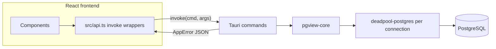

# pgview — Personal PostgreSQL Desktop Viewer (Tauri 2 + Rust)

Status: DRAFT v2 (GUI decision: Tauri) · Owner: Tomas · Scope: single user, macOS (arm64) first

## 1. Goal
A fast, read-mostly PostgreSQL browser for daily dev work: connect, browse schemas/tables, page through rows, filter/sort, run ad-hoc SQL, copy results. Replaces opening psql/TablePlus for quick looks.

### Non-goals (v1)
- Inline row editing / schema editing (DDL)
- Multi-DB engines (MySQL, SQLite)
- Code signing, notarization, auto-update, Windows/Linux builds
- ER diagrams, query plan visualizer, team sharing

## 2. Stack

| Layer | Choice | Why |
|---|---|---|
| Shell | Tauri 2 (`tauri`, `tauri-build`) | Rust backend, system WebView (WKWebView), ~10 MB app |
| Frontend | React 19 + TypeScript + Vite, pnpm | Familiar, largest component ecosystem |
| Data grid | `@glideapps/glide-data-grid` | Canvas-rendered, smooth on 100k+ loaded rows, column resize, selection, copy |
| SQL editor | CodeMirror 6 + `@codemirror/lang-sql` (`PostgreSQL` dialect) | Lighter than Monaco; schema-aware autocomplete from introspection data |
| UI state | Zustand | Small, no boilerplate |
| Styling | Tailwind CSS 4 | Fast to iterate for a personal tool |
| Async / driver | `tokio` + `tokio-postgres` + `deadpool-postgres` | `simple_query` returns every type as text (jsonb, arrays, enums, PostGIS): no per-type decoding |
| TLS | `tokio-postgres-rustls` + `rustls-native-certs` | Supabase / Neon / RDS require TLS |
| Secrets | `keyring` (macOS Keychain) | No plaintext passwords on disk |
| Config | `serde` + `toml` + `directories` | `~/Library/Application Support/pgview/connections.toml` |
| TS types from Rust | `ts-rs` | DTOs generated into `src/bindings/`; no hand-written duplicate types |
| Tauri plugins | `clipboard-manager`, `dialog` (save CSV), `window-state` | Official plugins only |
| Errors / logs | `thiserror` (serializable `AppError`), `tracing` | |

## 3. Architecture



- **Rust owns all database work**; the frontend never sees credentials beyond the edit form, and never builds SQL for browse mode.
- `AppState` (Tauri managed state): `HashMap<ConnId, Pool>`, `HashMap<RequestId, CancelToken>`, loaded profiles.
- Every data command takes a frontend-generated `request_id`. Frontend drops responses whose `request_id` is no longer current for that tab (user switched table).
- `cancel_query(request_id)` uses `tokio_postgres::CancelToken`. Each session sets `statement_timeout` (default 30s).
- **Safety default:** session `SET default_transaction_read_only = on`. Per-connection "Allow writes" toggle; tab bar shows a red badge when writes are allowed.
- **Payload size:** pages of 500 rows; cells truncated server-side to 2 KB (`left(col::text, 2048)`), full value fetched via `get_cell` on inspect. Keeps IPC JSON small.
- **Tauri security:** strict CSP (`default-src 'self'`), capabilities file grants only the plugins above; no `shell`, no `fs` plugin.

### Repository layout
```
pgview/
  Cargo.toml                    # workspace: crates/core, src-tauri
  package.json  vite.config.ts  tsconfig.json  index.html
  crates/core/                  # no Tauri deps; unit + integration tested
    src/{lib.rs, config.rs, secrets.rs, conn.rs, introspect.rs,
         paging.rs, query.rs, ident.rs, export.rs, history.rs, error.rs}
  src-tauri/
    tauri.conf.json  capabilities/default.json
    src/{main.rs, state.rs, commands/{conn.rs, schema.rs, data.rs, sql.rs, export.rs}}
  src/                          # React
    main.tsx  App.tsx  api.ts  store/
    bindings/                   # generated by ts-rs
    components/{Sidebar, ConnectionDialog, DataGrid, FilterBar,
                CellInspector, StructureTab, SqlEditor, Tabs, StatusBar}.tsx
  tests/fixtures/seed.sql
  docs/plans/
```

## 4. Contracts

### Rust DTOs (exported to TS via `ts-rs`)
```rust
struct ConnProfile { id: Uuid, name: String, host: String, port: u16, db: String,
                     user: String, ssl: SslMode, read_only: bool, color: Option<String> }
// password -> Keychain: service "pgview", account = profile.id

struct Column   { name: String, type_name: String, nullable: bool, is_pk: bool }
struct Page     { columns: Vec<Column>, rows: Vec<Vec<Option<String>>>,
                  next_cursor: Option<Cursor>, est_total: i64, elapsed_ms: u64 }
enum   Cursor   { Keyset(Vec<Option<String>>), Offset(u64) }
struct Filter   { column: String, op: FilterOp, value: Option<String> }   // op: = != < > <= >= LIKE ILIKE IS NULL IS NOT NULL IN
struct Sort     { column: String, desc: bool }
struct QueryResult { statement: String, columns: Vec<Column>, rows: Vec<Vec<Option<String>>>,
                     rows_affected: Option<u64>, elapsed_ms: u64, truncated: bool }

#[serde(tag = "kind")] enum AppError { Connect{msg}, Auth{msg}, Sql{code, msg, position}, Cancelled, Timeout, Internal{msg} }
```

### Tauri commands
| Command | Args | Returns |
|---|---|---|
| `list_profiles` / `save_profile` / `delete_profile` | profile, password? | `Vec<ConnProfile>` |
| `parse_conn_url` | `url` | `ConnProfile` + password |
| `import_pgpass` | — | `Vec<ConnProfile>` |
| `test_connection` / `connect` / `disconnect` | `conn_id` | server version |
| `list_schema_tree` | `conn_id` | schemas → relations (kind, est rows, size) |
| `describe_table` | `conn_id, schema, table` | columns, indexes, FKs, size |
| `fetch_page` | `request_id, conn_id, schema, table, filters, raw_where?, sort, cursor` | `Page` |
| `count_exact` | `request_id, conn_id, schema, table, filters` | `i64` |
| `get_cell` | `conn_id, schema, table, pk_values, column` | full text |
| `run_sql` | `request_id, conn_id, sql, max_rows=10000` | `Vec<QueryResult>` |
| `cancel_query` | `request_id` | `()` |
| `export_csv` | `request_id, conn_id, source(table+filters or sql), path` | rows written (streams to file in Rust) |
| `list_history` | `conn_id?, search?` | entries |

### Introspection
- Relations: `pg_namespace` + `pg_class` (relkind `r,v,m,p,f`), excluding `pg_catalog`, `information_schema`, `pg_toast`.
- Columns: `pg_attribute` + `format_type(atttypid, atttypmod)`; PK from `pg_index.indisprimary`.
- Row estimate: `pg_class.reltuples`; exact `count(*)` only on demand.
- Indexes: `pg_indexes`; FKs: `pg_constraint` (`contype='f'`); size: `pg_total_relation_size`.

### Paging and SQL building
- PK present, no custom sort: keyset `WHERE (pk) > ($cursor) ORDER BY pk LIMIT 500`.
- Otherwise `ORDER BY <sort> LIMIT 500 OFFSET n`.
- All identifiers via `ident::quote_ident()` (`"` doubled); values via `quote_literal()` (`'` doubled, `E''` when backslashes present). Single SQL-building path, unit tested.
- `raw_where` is passed verbatim (it's your own DB, read-only by default); errors surface with Postgres position.

## 5. Features (v1)
1. Connection manager: add/edit/delete/test, paste `postgres://` URL, import `~/.pgpass`, color tag.
2. Sidebar tree: schemas → tables/views/matviews, search, row estimate + size.
3. Data grid: virtualized, resizable columns, NULL styled distinctly, header click sort, load more on scroll.
4. Filter bar (`column op value`, multiple, AND) + raw WHERE input.
5. Cell inspector panel: full value, pretty JSON for json/jsonb, hex for bytea.
6. Structure tab: columns, types, defaults, indexes, FKs, size.
7. SQL editor: PG highlighting, schema autocomplete, run selection/all (Cmd+Enter), multiple result sets, cancel (Esc), history (JSONL, last 1000).
8. Copy cell / selection as TSV, CSV, JSON, `INSERT`; export result or full table to CSV (streamed).
9. Tabs; persisted open tabs + window state.
10. Dark/light following macOS appearance.

## 6. Build milestones

| ID | Deliverable | Verify |
|---|---|---|
| BUILD-01 | Scaffold: `pnpm create tauri-app` (React-TS), cargo workspace with `crates/core`, Tailwind, Zustand, ts-rs export step | `pnpm tauri dev` opens window; `ping` command round-trips |
| BUILD-02 | `core::config` + `secrets` + profile commands | `cargo test -p pgview-core config`; password absent from TOML |
| BUILD-03 | `core::conn`: TLS/no-TLS, read-only session, timeout, cancel registry; `AppError` | `cargo test -p pgview-core conn` vs fixture DB |
| BUILD-04 | Connection dialog, URL paste, pgpass import, test button | Manual: connect to `pgview_fixture` |
| BUILD-05 | `core::introspect` + Sidebar tree with search | Test asserts fixture relations listed |
| BUILD-06 | `core::ident` + `core::paging` (keyset/offset, filters, sort) | Unit tests: quotes, spaces, unicode, injection strings |
| BUILD-07 | DataGrid (Glide): paging on scroll, NULL style, sort, stale-response drop | Scroll `orders` (1M rows) to 200k smoothly |
| BUILD-08 | FilterBar + raw WHERE + CellInspector (`get_cell`) | Manual on `all_types` |
| BUILD-09 | StructureTab (`describe_table`) | Matches `\d+ orders` |
| BUILD-10 | SqlEditor (CodeMirror), multi-result, cancel, history | `SELECT pg_sleep(60)` cancels < 1s |
| BUILD-11 | Copy formats + streamed CSV export via dialog plugin | 1M-row export, RAM stays flat |
| BUILD-12 | Tabs, shortcuts, persisted session, window-state, theme | Restart restores tabs |
| BUILD-13 | `pnpm tauri build` → `pgview.app` / `.dmg`, install to `/Applications` | Launch from Spotlight |

Usable viewer after BUILD-07 (≈1 week); full v1 after BUILD-13 (≈2 weeks).

## 7. Test seam
- `tests/fixtures/seed.sql` creates `pgview_fixture` on local Homebrew Postgres 18:
  - `orders` 1,000,000 rows (`generate_series`, bigint PK)
  - `all_types`: int, numeric, text, varchar, bool, uuid, date, timestamptz, interval, jsonb, int[], text[], bytea, enum, inet, NULLs, literal text `'NULL'`
  - `"Weird ""Name"" Table"` in schema `"Sales Data"`
  - view, materialized view, partitioned table, table without PK
  - role `pgview_ro` (SELECT only)
- Rust: `PGVIEW_TEST_URL` drives integration tests in `crates/core` (all DB logic lives there, so most coverage needs no UI).
- Frontend: Vitest + `@tauri-apps/api/mocks` `mockIPC` for store/component logic (stale-response drop, filter serialization).
- Note: `tauri-driver` WebDriver does not support macOS, so full-app E2E is the manual checklist below.

```bash
createdb pgview_fixture && psql pgview_fixture -f tests/fixtures/seed.sql
export PGVIEW_TEST_URL=postgres://localhost/pgview_fixture
cargo test --workspace && pnpm vitest run
```

## 8. Acceptance (manual E2E)

| ID | Scenario | Pass |
|---|---|---|
| E2E-01 | Add connection by URL | Password in Keychain; `grep` on TOML finds none |
| E2E-02 | Wrong password / host down | Typed error toast; UI responsive |
| E2E-03 | Open `orders`, scroll to row 200k | No freeze; app memory < 600 MB |
| E2E-04 | Open `all_types` | Every type renders; SQL NULL distinct from text `'NULL'` |
| E2E-05 | Quoted schema/table names | Opens, sorts, pages correctly |
| E2E-06 | Filter `status = 'paid'` + sort `created_at desc` | Matches psql output |
| E2E-07 | `DELETE FROM orders` with read-only on | Postgres read-only transaction error shown |
| E2E-08 | `SELECT pg_sleep(60)` then Esc | Cancelled < 1s |
| E2E-09 | Copy 10 rows as INSERT, run in psql scratch DB | Succeeds |
| E2E-10 | Rapidly click 5 tables | Grid shows last-clicked table only |
| E2E-11 | Export `orders` to CSV | 1,000,001 lines incl. header |
| E2E-LIVE-01 | Connect to a TLS remote (Supabase/Neon), browse one table | Works with `sslmode=require` |

## 9. Prerequisites
```bash
curl --proto '=https' --tlsv1.2 -sSf https://sh.rustup.rs | sh   # Rust not installed yet
brew services start postgresql@18                               # psql 18.4 present
# Already present: Node 24, pnpm, Xcode
```

## 10. Open decisions
1. Query history store: JSONL (default) vs SQLite.
2. v2 candidates: inline editing (`UPDATE ... WHERE pk=`), EXPLAIN viewer, SSH tunnel (`russh`), Linux/Windows builds.
